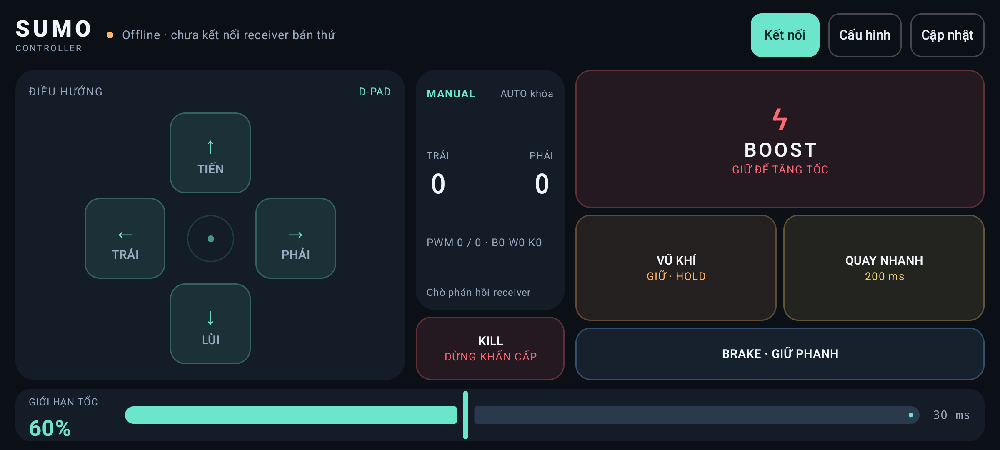

# Sumo Controller

Ứng dụng Android điều khiển xe Sumo bằng Kotlin và Jetpack Compose, kiểm thử với UDP simulator `SUMO-SIM/1-draft1`.



[Xem toàn bộ ảnh giao diện](docs/screenshots/README.md) · [Mô tả dự án](docs/MO_TA_DU_AN.md) · [Checkpoint](docs/testing/TIEN_DO_AI.md)

## Chức năng

- Điều khiển ngang bằng D-Pad hoặc joystick, hỗ trợ nhiều ngón.
- Limiter, Boost, Brake, Kill/mở khóa, vũ khí HOLD/TOGGLE và macro quay.
- Chỉnh và lưu IP/port, chu kỳ gửi, độ nhạy, vùng chết, hệ số bánh và thời gian quay ngay trong app.
- Giao diện kiểm tra/tải/cài APK cập nhật; luồng HTTPS trên điện thoại vẫn chưa kiểm chứng.
- UDP simulator Python độc lập và các test Kotlin/Android.

## Chạy dự án

Mở thư mục này trong Android Studio, dùng JDK của Android Studio và cài Android SDK 37. Ứng dụng yêu cầu Android 16/API 36 trở lên; các ảnh hiện tại chụp trên AVD Android 17/API 37.

```powershell
.\gradlew.bat :app:assembleDebug
.\gradlew.bat :app:testDebugUnitTest :app:lintDebug
py -3.13 tools/sumo_simulator.py --host 127.0.0.1 --port 8888
```

Trong app trên AVD, đặt IP `10.0.2.2`, port `8888`, rồi nhấn **Kết nối**. Simulator chỉ bind loopback. AUTO mặc định khóa.

## Trạng thái kiểm chứng

G5 đã chốt **có điều kiện cho chức năng AVD**. STOP/cadence vẫn là lỗi mở, chặn dùng xe và release. G3/G4 còn chờ duyệt; chưa chuyển Phase 6/7.

Xem [biên bản G5](docs/testing/phase-5/BIEN_BAN_DUYET.md) và [kết quả bổ sung](docs/testing/phase-5/KET_QUA_BO_SUNG_G5.md) để phân biệt các lượt test, binary và giới hạn. Điện thoại, cập nhật HTTPS, API 36, I11, firmware và xe thật còn chưa kiểm chứng.

Repo chứa mã nguồn, tài liệu, tóm tắt kiểm chứng và ảnh giao diện. APK, khóa ký, cấu hình máy, thư mục build và các bản ghi thô dung lượng lớn giữ ngoài Git; hồ sơ đầy đủ vẫn giữ tại workspace gốc. Repo này chưa công bố APK hoặc bản release.
