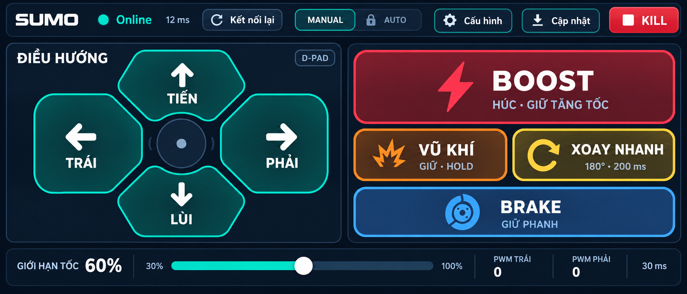
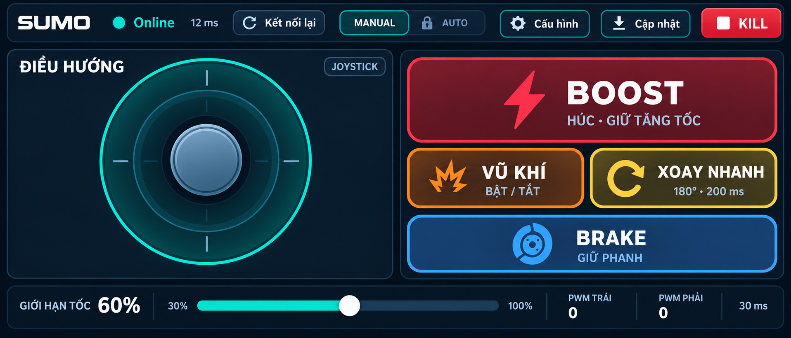
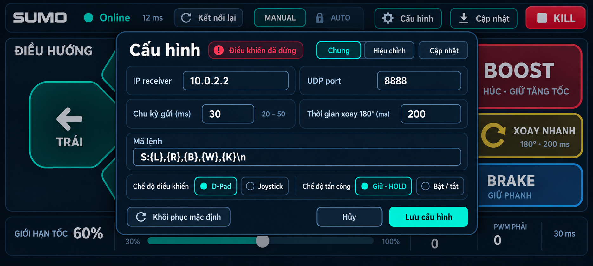
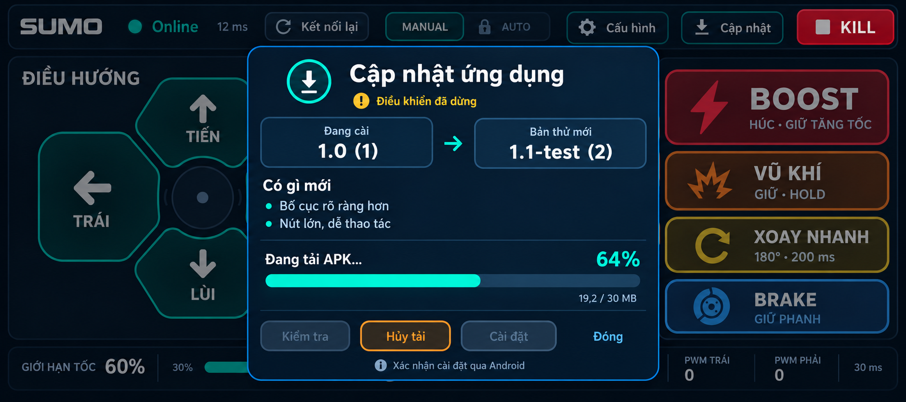

# Mockup Sumo đối chiếu đặc tả gốc

**Bản mới nhất:** [v3 — bố cục gọn và Chẩn đoán](v3-compact-diagnostics/README.md), theo yêu cầu thu nhỏ nút và bổ sung nhật ký của người dùng. Bộ v2 bên dưới giữ làm tham khảo lịch sử.

Bộ v2 được tạo sau khi người dùng yêu cầu bám sát `Dac_Ta_Ky_Thuat_App_Dieu_Khien_Xe_Sumo.docx`. Đây là ảnh thiết kế, chưa áp dụng vào app. Các số ping, PWM, phiên bản và tiến trình tải là dữ liệu minh họa.

## Yêu cầu giữ lại

| Nguồn yêu cầu | Áp dụng vào thiết kế |
|---|---|
| SRS 1, 2.1–2.3 | Màn hình ngang, fullscreen, điều khiển hai ngón cái; vùng điều hướng trái, tấn công phải và công cụ. Tỷ lệ đích khi triển khai là khoảng50/40/10; ảnh AI là minh họa, chưa dùng để xác nhận tỷ lệ pixel hoặc kích thước vùng chạm. |
| SRS 2.1; G0 | D-Pad4hướng và chế độ joystick thay thế; không thêm nút STOP giữa D-Pad. |
| SRS 2.2 | BOOST màu đỏ, lớn nhất trong các nút tấn công; vũ khí cam có HOLD/TOGGLE; xoay nhanh vàng; Brake xanh dương. |
| SRS 2.3 | Online xanh/Offline đỏ, ping, Kết nối lại, limiter30–100%, MANUAL/AUTO và Kill riêng. AUTO tiếp tục khóa theo G0. |
| SRS 4.4 | Cấu hình dạng modal, có IP,port,mã lệnh và thời gian xoay; giữ đường vào phần hiệu chỉnh và cài đặt cập nhật. |
| SRS 2.1,4 | STOP≤10ms,đa điểm chạm,watchdog300ms và rung vẫn là yêu cầu hành vi; ảnh mockup không chứng minh các yêu cầu này đạt. |
| Bổ sung người dùng | Hộp cập nhật APK,ghi chú phiên bản,tiến trình tải,Hủy và cài qua Android. Đây là yêu cầu bổ sung,không gán thành nội dung có sẵn trong SRS gốc. |

Nhãn180° là mục tiêu từ SRS;200ms là ví dụ timer,không chứng minh xe xoay đúng góc. Khi triển khai,mở modal phải dừng/đóng phiên theo quy tắc hiện tại; nền mờ của ảnh là minh họa,không phải trạng thái runtime đã được xác minh.

## D-Pad

## Joystick

## Cấu hình dạng hộp thoại

## Cập nhật APK

Tạo bằng công cụ imagegen tích hợp; [prompt dùng tạo bộ v2](PROMPTS_SRS_V2.md). Bản v1 có lưới tấn công bằng nhau và Cấu hình toàn màn hình được giữ làm lịch sử,không dùng triển khai. Chưa sửa mã,build APK hoặc đẩy bộ mockup này lên GitHub. Lỗi hiệu năng và trạng thái G5 không thay đổi.
