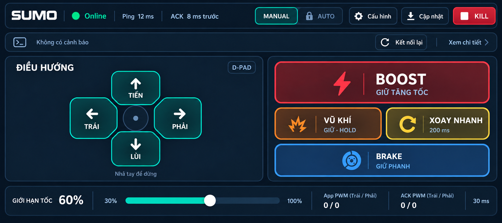
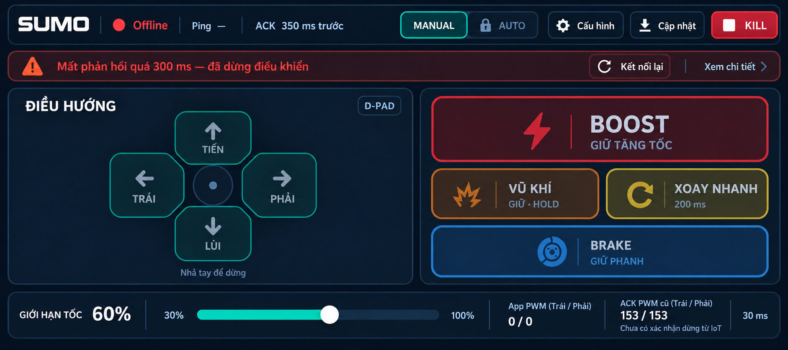
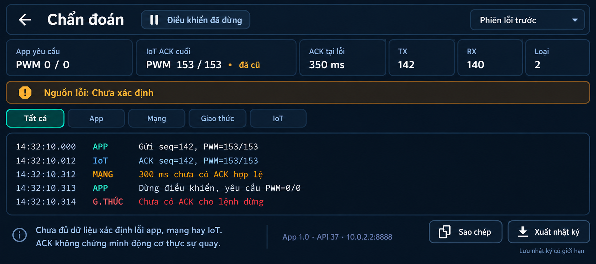
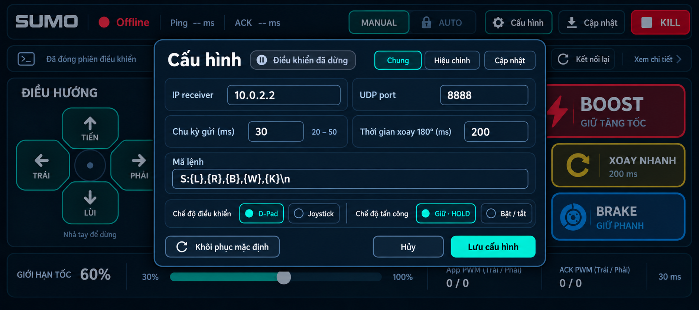
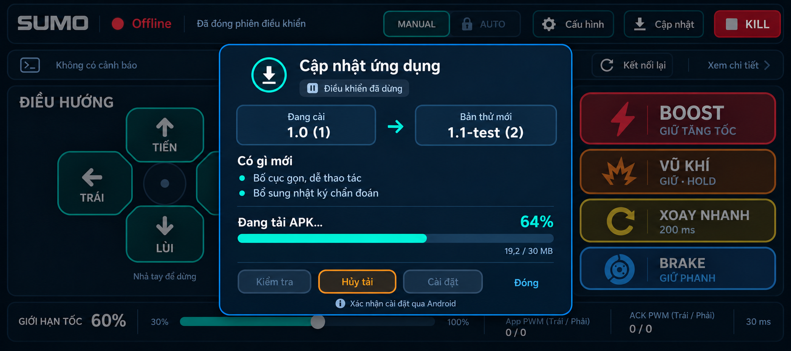

# Mockup Sumo gọn hơn và bổ sung Chẩn đoán

**Cập nhật sau khi người dùng duyệt:** đã triển khai vào app và chụp [bộ ảnh chạy thật](../../../screenshots/ui-compact-2026-10-18/README.md). Các câu Chưa triển khai bên dưới mô tả thời điểm tạo mockup; kết quả hiện tại và giới hạn nằm trong [báo cáo UI](../../../testing/ui-compact-2026-10-18/KET_QUA.md).

Bộ v3 chỉnh theo ba ảnh người dùng cung cấp: thu gọn D-Pad, chữ và biểu tượng; thêm trạng thái lỗi trên màn chính và màn Chẩn đoán riêng. Đây là ảnh tạo bằng imagegen, chưa thay giao diện hoặc chức năng trong ứng dụng.

Giữ màu chức năng theo SRS: BOOST đỏ và lớn nhất trong các nút tấn công, vũ khí cam, xoay nhanh vàng, Brake xanh dương, Kill riêng. AUTO khóa theo G0. Cấu hình tiếp tục dạng modal với IP, port, mã lệnh và thời gian xoay. Tỷ lệ vùng và kích thước dp cần xác nhận khi triển khai; không suy kích thước vùng chạm thật từ pixel ảnh.

## Màn chính bình thường

Điều hướng và nút tấn công gọn hơn, dành khoảng thở giữa các nhóm. Kết nối, ping và tuổi ACK chỉ hiện một lần. Dải sự kiện có vị trí cố định, chạm Xem chi tiết để mở Chẩn đoán. App PWM và ACK PWM hiển thị tách biệt.

## Màn chính khi mất phản hồi

Cảnh báo thay nội dung trong dải có sẵn; giữ vị trí nút lái. Hiển thị Offline, ACK quá hạn, PWM app yêu cầu0/0 và ACK cũ153/153; chưa có xác nhận dừng từ IoT. Không khẳng định xe đã dừng cơ học hoặc tự kết luận mạch bị lỗi.

## Chẩn đoán riêng

Mở màn này dừng điều khiển theo quy tắc an toàn. Nhật ký chỉ đọc, phân nhóm App/Mạng/Giao thức/IoT; có lệnh yêu cầu, ACK cuối cùng, số gửi/nhận/phản hồi loại bỏ, chọn phiên lỗi trước, Sao chép và Xuất nhật ký. Nhãn Loại trong ảnh mang nghĩa số phản hồi bị loại bỏ, không phải mã loại lỗi.

Nguồn lỗi được giữ Chưa xác định khi thiếu bằng chứng. ACK không chứng minh động cơ thực sự quay; thông tin nguồn, reset, driver hoặc động cơ cần firmware cung cấp. Không thêm giá trị phần cứng giả. Cơ chế ghi/lưu log có giới hạn và xuất file mới là thiết kế đề xuất, chưa được triển khai hoặc đo ảnh hưởng hiệu năng.

## Cấu hình

Hộp thoại gọn hơn, giữ các trường bắt buộc và lựa chọn D-Pad/joystick, HOLD/TOGGLE. Nền thể hiện phiên điều khiển đã đóng; Offline do chủ động mở modal không bị mô tả thành lỗi mất ACK.

## Cập nhật

Hộp cập nhật dùng chữ và nút vừa phải. Cài đặt bị vô hiệu trong lúc đang tải; Hủy tải vẫn dùng được. Phiên bản1.1-test, tiến trình64% và ghi chú chẩn đoán là minh họa thiết kế, không phải bản APK đã tồn tại hoặc thông báo server thật.

## Phạm vi

- Các thời gian, seq, PWM, số gói, phiên bản và nhật ký đều là dữ liệu minh họa; không dùng làm bằng chứng kiểm thử.
- Chưa sửa mã, build APK, tạo dữ liệu nhật ký thật hoặc đẩy bộ ảnh này lên GitHub. G5 có điều kiện và lỗi STOP/cadence không thay đổi.
- Khi triển khai cần kiểm tra vùng chạm, tương phản, chữ trên điện thoại, bảo toàn đa pointer/STOP/Kill và đo chi phí chẩn đoán; cập nhật UI/ghi log không được chặn luồng gửi điều khiển.
- [Prompt đã dùng](PROMPTS.md). Các bản ảnh trước vẫn giữ nguyên; màn chính được chọn là01-main-compact.png, không phải bản nháp lặp trạng thái.
