# Toàn bộ màn hình và hộp thoại chính của Sumo Controller

Ảnh chụp thật ngày 18/10/2026 trên AVD Medium_Phone, Android 17/API 37, kích thước gốc 2400 × 1080. Nhấn vào ảnh để xem bản gốc.

APK được chụp có SHA-256 `92abb62d00eb6f841eb8b9eb158d4b0be4b98bd39c6e05bd39b69de79613e5e3`. Không sửa giao diện, mã sản phẩm hoặc rebuild trong đợt này. Các lựa chọn tạm thời trên AVD được khôi phục sau chụp.

G5 giữ có điều kiện cho chức năng AVD. STOP/cadence còn lỗi mở; chưa dùng xe hoặc release. Các màn tải/cài bản mới thành công cần nguồn HTTPS thực và không được dựng giả trong bộ ảnh này.

[Về trang dự án](../../README.md) · [Mô tả dự án](../MO_TA_DU_AN.md)

## D-Pad — chưa kết nối

Màn hình chính, giới hạn tốc độ, Boost, vũ khí HOLD, quay nhanh và Brake.

## D-Pad — Online với simulator

Receiver loopback trên máy phát triển; đây không phải kết nối xe thật.

[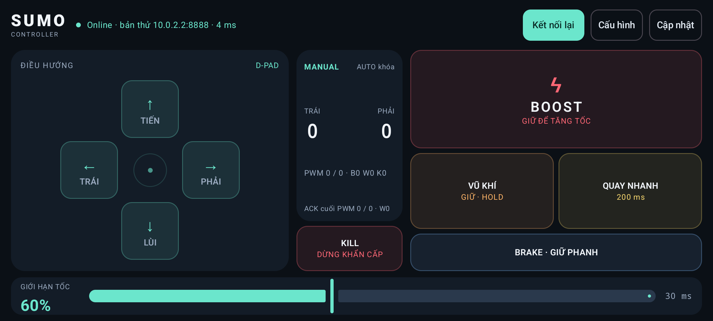](2026-10-18/02-dpad-online.png)

## Joystick — chưa kết nối

Chế độ joystick và nút vũ khí TOGGLE.

[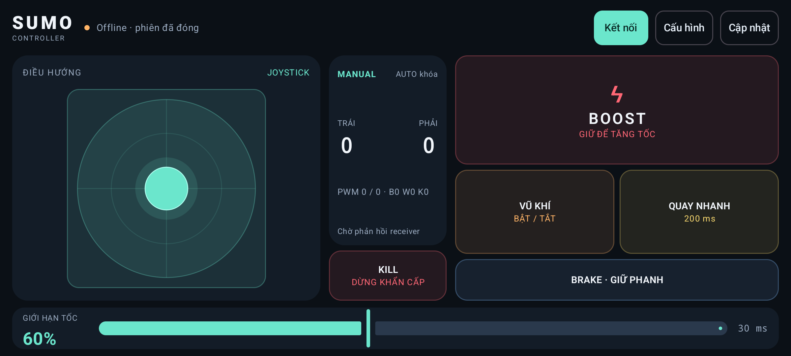](2026-10-18/03-joystick-offline.png)

## Joystick — Online với simulator

Hiển thị trạng thái kết nối và ACK bên nhận.

[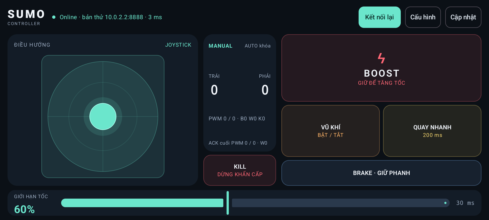](2026-10-18/03b-joystick-online.png)

## Kill — đã khóa và giữ mở khóa

Trạng thái dừng khẩn cấp, nút giữ mở khóa 1 giây và chờ ACK.

[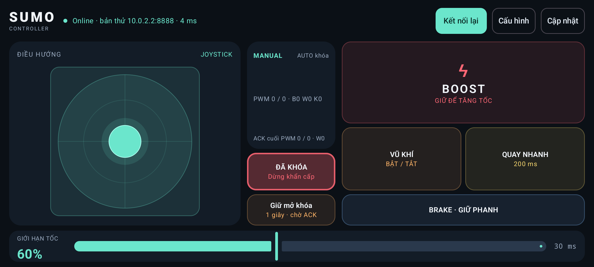](2026-10-18/04-kill-locked.png)

## Cấu hình — chế độ và kết nối

D-Pad/joystick, HOLD/TOGGLE, IP, port, chu kỳ gửi và template.

## Cấu hình — lái và hiệu chỉnh

Limiter, độ nhạy, vùng chết, mức quay và hệ số hai bánh.

[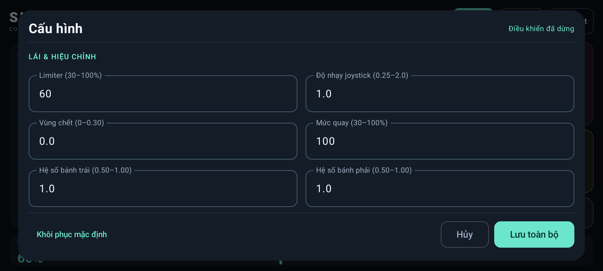](2026-10-18/06-settings-driving.png)

## Cấu hình — thời gian quay và nguồn cập nhật

Phần cuối sau khi cuộn: thời gian quay, URL metadata HTTPS và trạng thái AUTO khóa.

[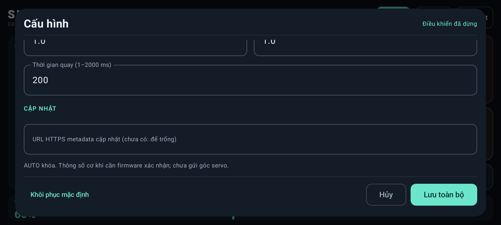](2026-10-18/07-settings-calibration-update.png)

## Xác nhận khôi phục mặc định

Chỉ mở hộp xác nhận rồi Hủy; không reset cấu hình.

[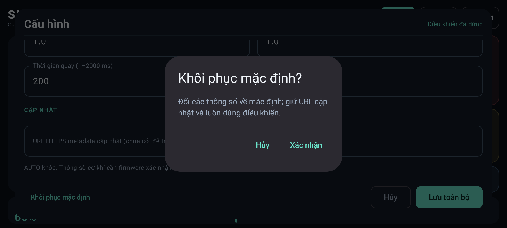](2026-10-18/08-reset-confirmation.png)

## Cập nhật APK test — chưa cấu hình nguồn

Kèm thông báo cài đặt lỗi được giữ từ phiên kiểm thử AVD trước. Phiên chụp không tải hoặc cài bản mới.

[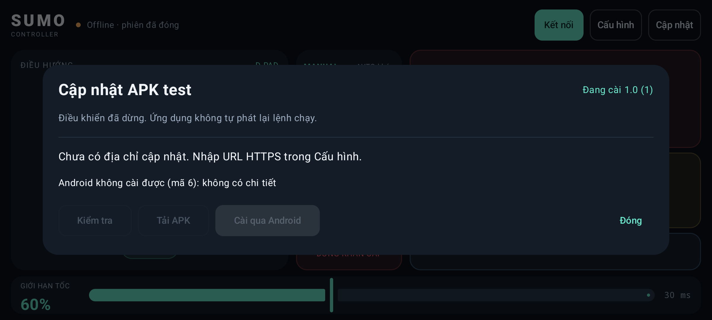](2026-10-18/09-updater-no-feed.png)

## Cấu hình — chọn joystick và TOGGLE

Hai lựa chọn điều khiển và chế độ vũ khí.

[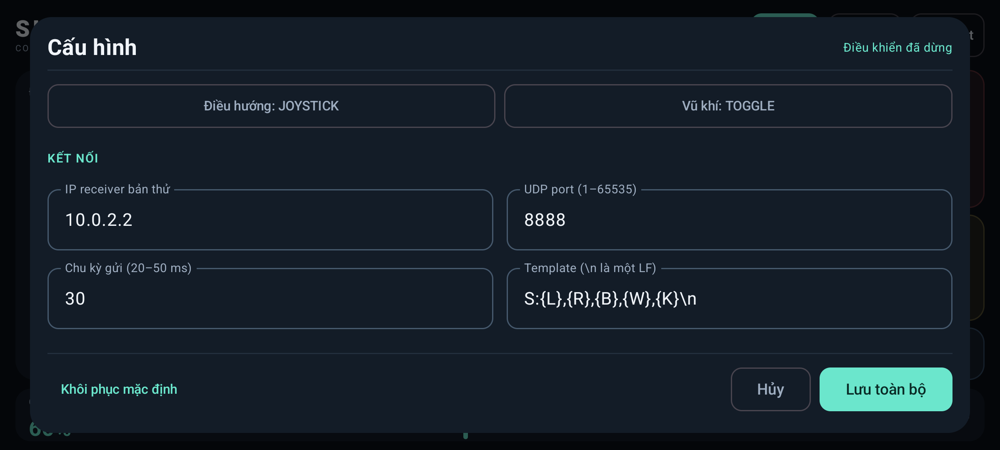](2026-10-18/10-settings-joystick-toggle.png)

## Vũ khí TOGGLE — đang bật

Trạng thái bật được phản hồi bởi simulator; không vận hành cơ cấu thật.

[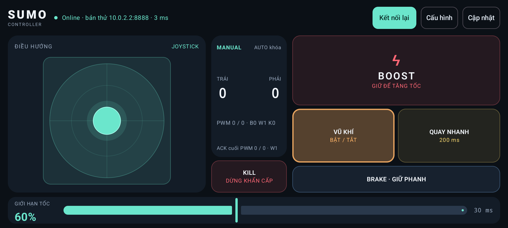](2026-10-18/11-weapon-toggle-active.png)

## Cấu hình — báo lỗi thông số

Nhập thử chu kỳ gửi 1 ms để chụp thông báo ngoài miền 20–50 ms; giá trị sai không được lưu.

[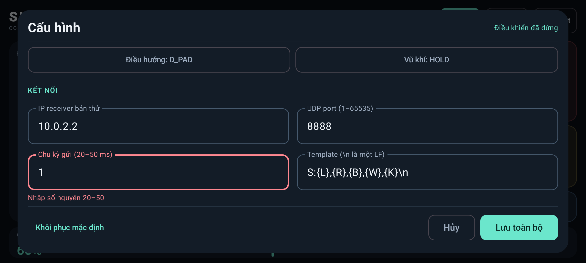](2026-10-18/12-settings-validation-error.png)

## Xác nhận đổi nguồn cập nhật

URL example.com chỉ dùng mở hộp xác nhận rồi Hủy; không lưu hoặc kết nối nguồn mẫu.

[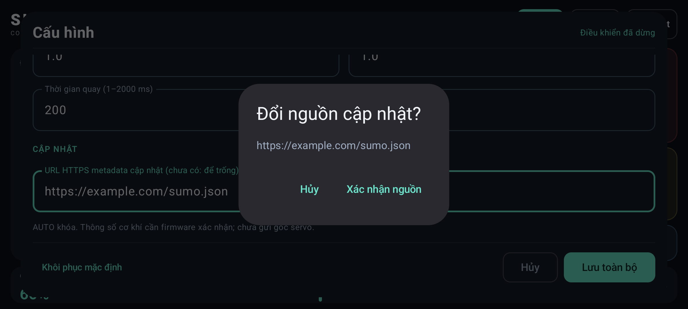](2026-10-18/13-update-source-confirmation.png)
