# Giao diện compact và Chẩn đoán — ảnh app thật

Ứng dụng đã được chỉnh theo mockup v3. Có **4 giao diện chức năng**: Điều khiển, Chẩn đoán, Cấu hình và Cập nhật; các tab/trạng thái không phải màn chức năng mới. Bộ này có **12 ảnh trong app** và **1 ảnh hộp xuất file của Android**.

Ảnh lấy trực tiếp từ AVD Android 17/API 37 với APK debug SHA256 `c8f88cbcb3dd5fb2abdcd1bb7eb0608b2d2c1b27b9bd3ffa7b7d9aafbfcd9f55`. Mười hai ảnh app có kích thước 2400×1080; hộp hệ thống ở ảnh13 dùng 1080×2400. Không dựng số liệu hoặc ghép ảnh. [Manifest và checksum](manifest.json) · [Kết quả kiểm tra](../../testing/ui-compact-2026-10-18/KET_QUA.md).

## Điều khiển

D-Pad thu gọn; BOOST vẫn là nút tấn công lớn nhất, giữ đỏ/cam/vàng/xanh theo đặc tả. Kill ở trên cùng; dải cảnh báo giữ vị trí cố định. Có ping, tuổi ACK và tách App PWM với ACK PWM. Điều khiển thật trong bộ ảnh là với simulator Python ở máy chủ, chưa phải firmware/xe.

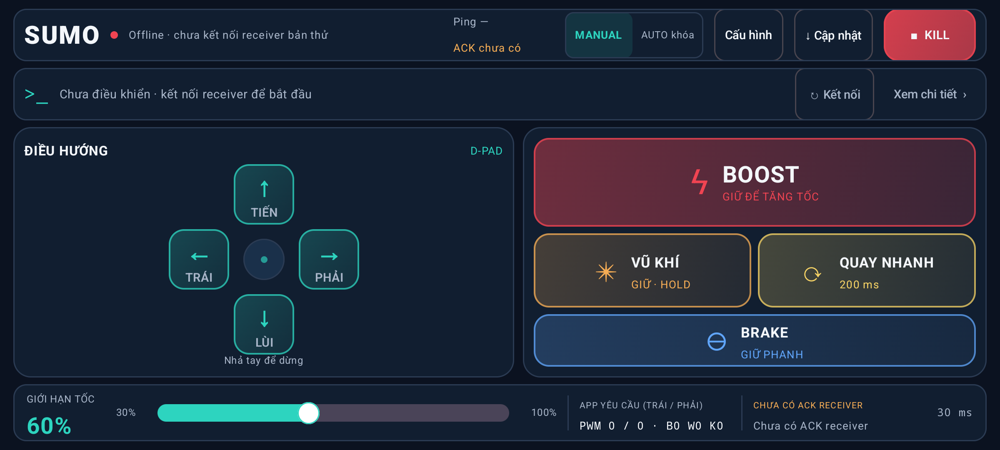

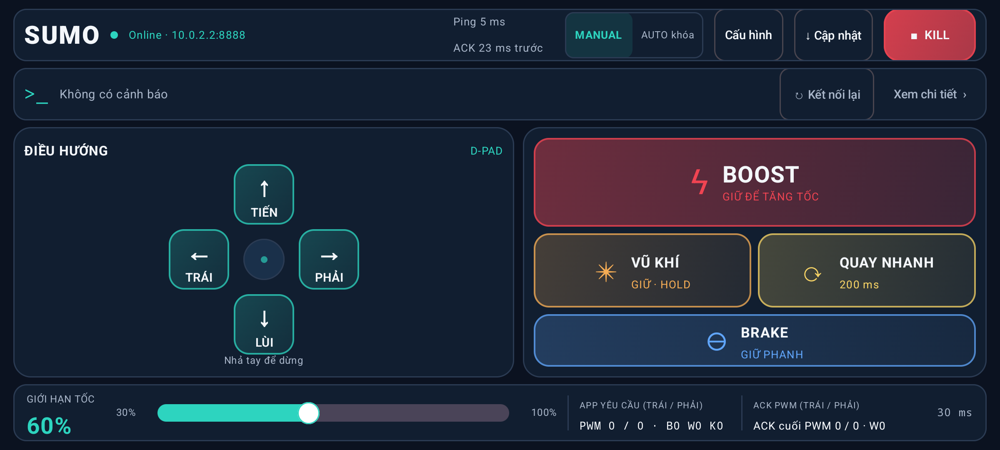

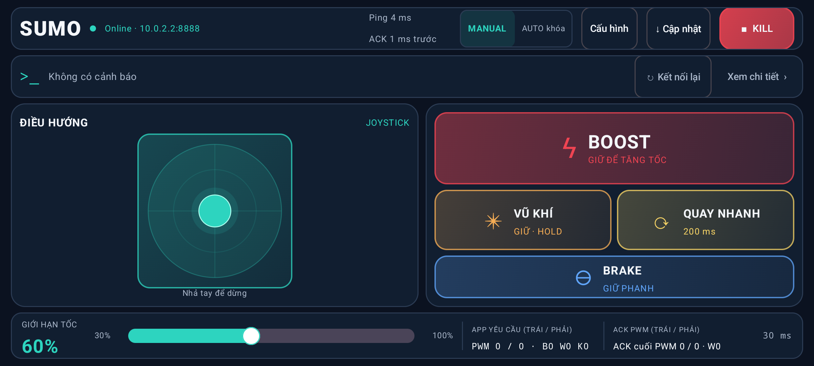

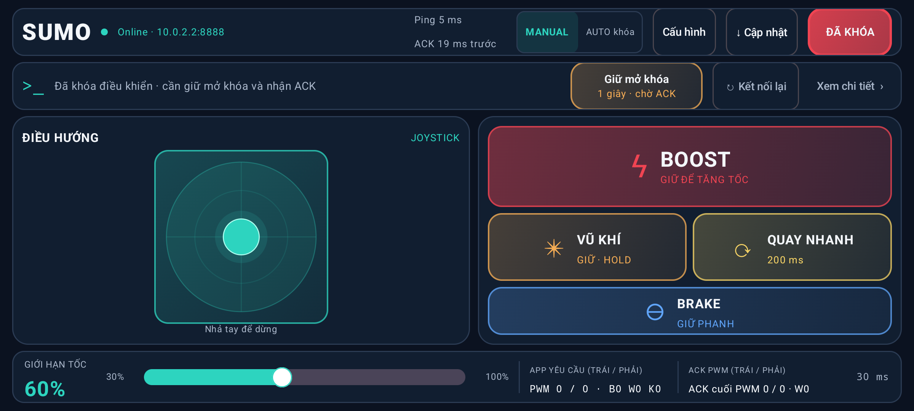

Mất phản hồi được tạo bằng kịch bản `drop-reply` thật. App yêu cầu PWM0/0; ACK cuối153/153 được ghi rõ là cũ. Tuổi ACK tiếp tục tăng sau timeout300ms nên số trong ảnh không phải ngưỡng timeout. Không suy ACK thành bằng chứng động cơ quay/dừng.

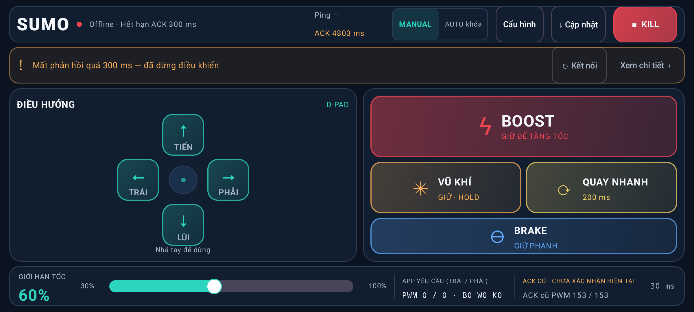

## Chẩn đoán

Mở Chẩn đoán đóng phiên điều khiển. Có nhóm App/Mạng/Giao thức/IoT, bộ đếm TX/RX/bị loại, yêu cầu app, ACK cuối, lý do loại phản hồi, sao chép/xuất và phiên lỗi trước. UI cập nhật theo đợt250ms; tối đa240dòng hiện tại, báo cáo có giới hạn dung lượng. Nguồn lỗi giữ Chưa xác định nếu thiếu bằng chứng; thiếu quyền hoặc mã từ chối được ghi theo thông tin thực nhận.

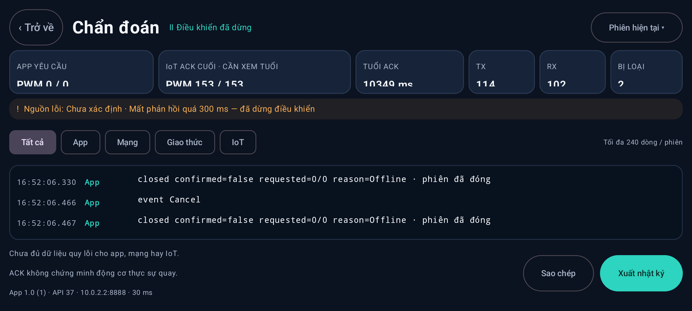

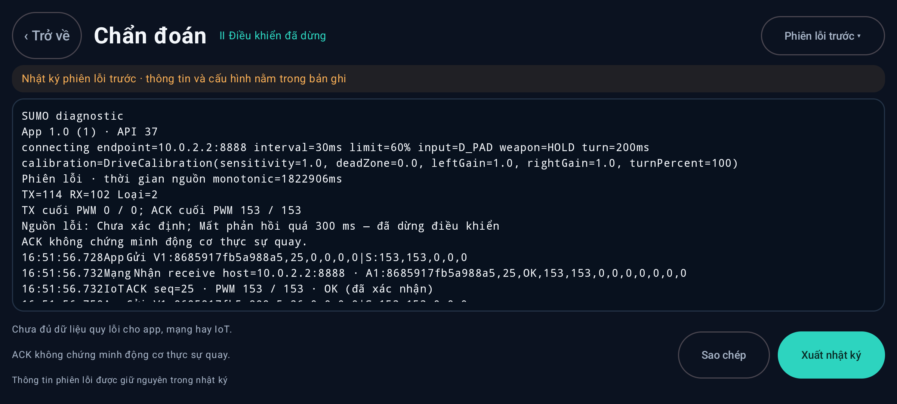

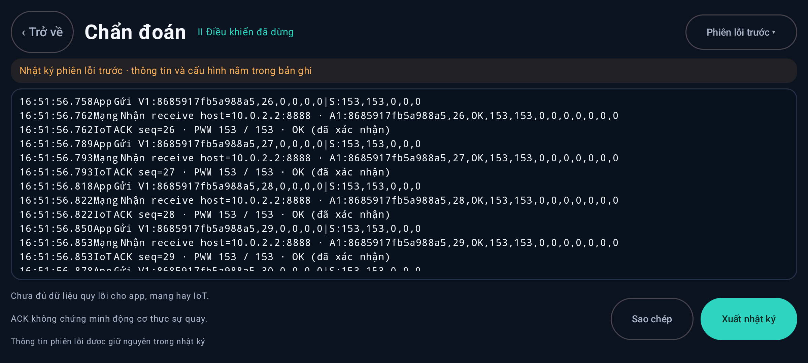

## Cấu hình

Ba tab cùng một hộp thoại. Đổi tab giữ bản nháp; Hủy không lưu, Lưu áp dụng toàn bộ sau validation. Đổi các thông số này không cần build lại app.

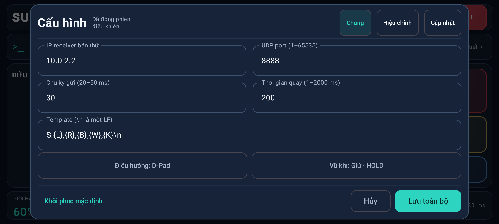

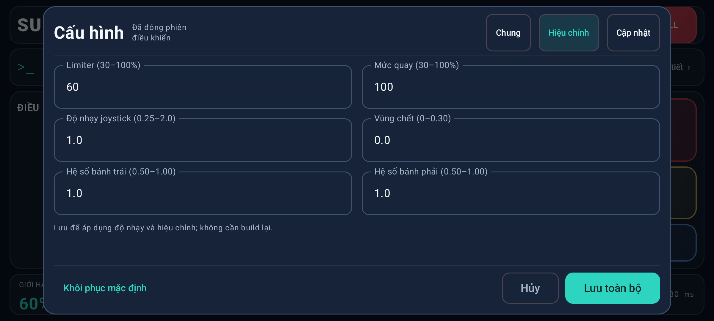

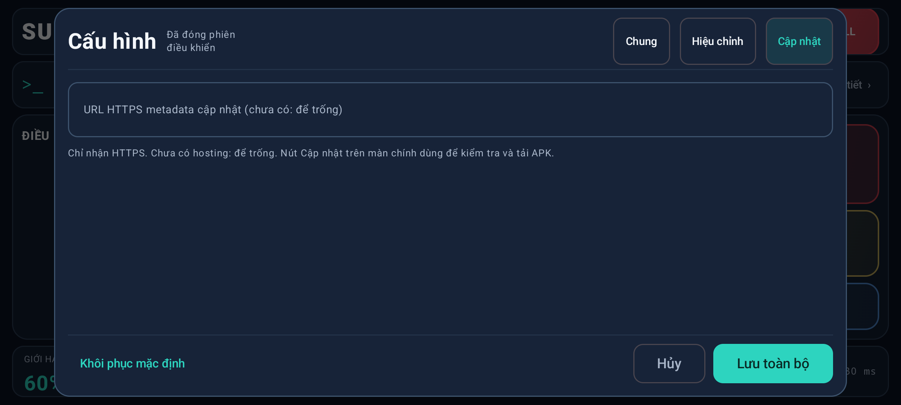

## Cập nhật

Chưa cấu hình hosting nên app hiện Chưa kiểm tra và khóa nút tải/cài. Dòng lỗi cài đặt mã6 trong ảnh là kết quả fixture kiểm thử Android đã được lưu trước đợt chụp; đợt chụp không tải/cài bản mới. Cấu hình gốc và lịch sử này được giữ nguyên.

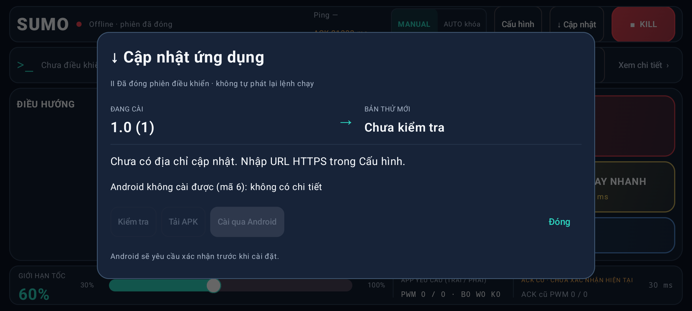

## Xuất file qua Android

Đã dùng hộp hệ thống để lưu báo cáo phiên lỗi thực tế20.059byte, kiểm tra lại nội dung và checksum. Đây là hộp của Android, không phải giao diện chức năng thứ5 của app.

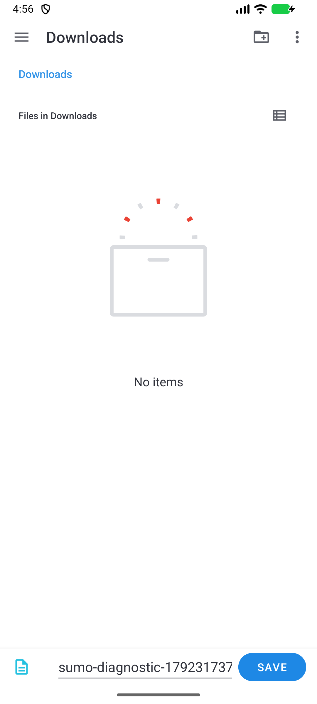

## Phạm vi kiểm chứng

118unit,33ca UI/Settings/UDP chức năng phân biệt theo testcase và8kịch bản lỗi mạng có bằng chứng trong báo cáo. Lượt STOP500/cadence mới đạt cận đã duyệt trên AVD; không xóa FAIL cũ hoặc đổi quyết định G5 có điều kiện. Chưa thử trên điện thoại/xe thật, chưa release hoặc upload APK. Các ảnh mockup lịch sử vẫn được giữ riêng.
